# Hardware System Design Explorer

An interactive sizing tool for data-processing systems: a host CPU and its memory, a host link
(PCIe or on-package UCIe), accelerators with on-chip SRAM and device DRAM, scale-up fabrics and
scale-out networks up to many racks, optionally fed from the network or NVMe storage. You set the requirements (processing rate, latency budget, block size,
peak-to-average ratio, headroom) and the workload (bytes over the link and through DRAM per byte
processed, arithmetic per byte), and it shows which component is the bottleneck. It also gives the
minimum specification of every component, and the power, performance and area (PPA) of the result.

**Live app:** https://hw-system-design-explorer.vercel.app/ (also mirrored on [GitHub Pages](https://brendanjameslynskey.github.io/HW_System_Design_Explorer/))

**Case study:** [what it models, how it is checked, and five things it shows](CASE_STUDY.md)

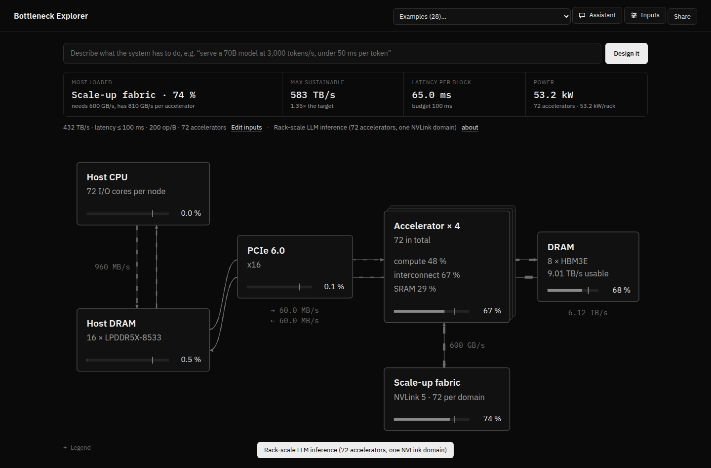

## Layout

A sober black-and-white page with little on screen at once: the verdict, a one-line summary of the
requirements and a compact live block diagram, with the analysis in tabs below. Detail is hidden until
you ask for it: hover a block for its figures, click it for its settings, and open the legend, the
example's description, the less-used tabs (Latency, Headroom, Roofline, Model), the impractical DRAM
options and the passing checks only when you want them. Status is shown by weight and inversion rather than colour
(grey within the utilisation ceiling, dashed above it, white over capacity, the bottleneck inverted).
Inputs live in a drawer that slides in from the left; clicking any block opens its settings in a drawer
on the right. On wide screens the drawers push the page aside so the diagram stays visible while you drag.

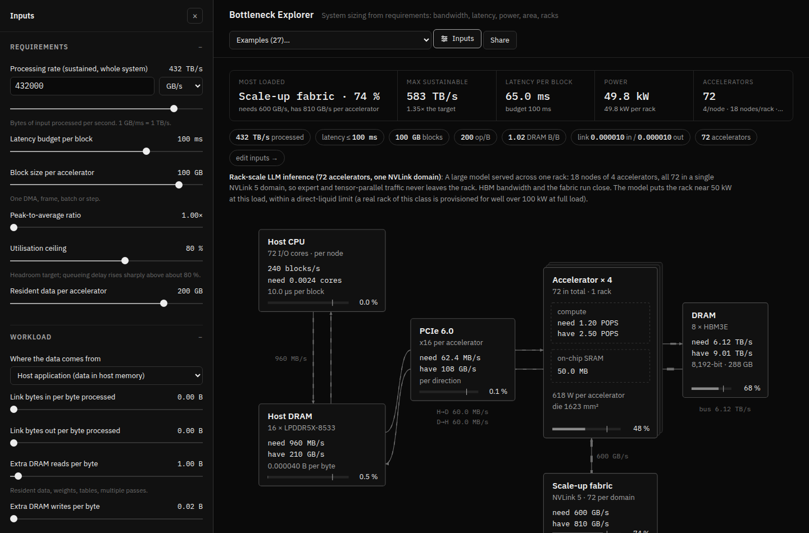

## Many accelerators and racks

Set accelerators per node, nodes per rack and racks. Each accelerator then handles its share of the
rate and each host its node's share. Peer traffic splits into what stays inside the scale-up domain
(a node or a whole rack, over PCIe peer-to-peer, NVLink 4/5, UALink or Ethernet scale-up) and what
crosses the scale-out network (200G to 1.6T NICs). The *Racks* tab draws the rack elevation and
checks rack power against a cooling limit (air, rear-door, direct liquid). The sizing says how many
accelerators this design needs, and the fabric table shows which fabrics fit and whether the domain is
too big for them.

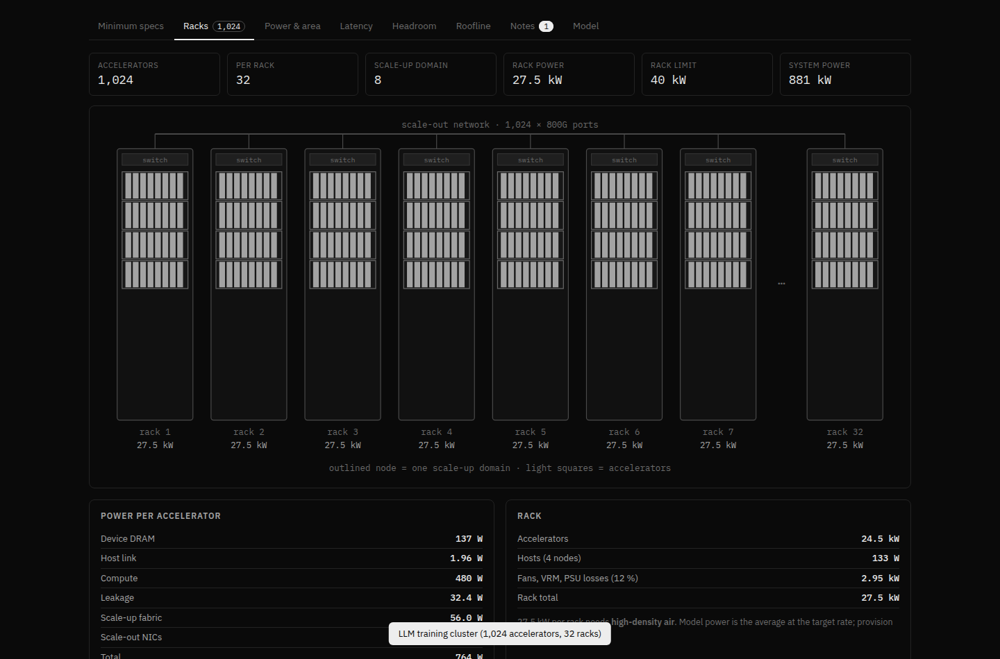

## Design assistant

Type what the system has to do in plain language, for example *"serve a 70B model at 3,000 tokens/s,
under 50 ms per token"*, and the assistant turns it into the model's inputs. It asks up to three short
follow-up questions with clickable answers when something that would change the design is missing, and
assumes typical values (and says so) when you can't say. It then picks the hardware itself, or runs the
optimiser, until every component sits under the utilisation ceiling, and the page redraws as it goes.

It runs in your browser with **your own API key** from **OpenAI, Google (Gemini) or OpenRouter**
(Anthropic works too). Pick the provider, paste the key, and choose a model from the provider's own live
list; a sensible default is preselected. The key goes only to that provider's API, and it is kept only in
your browser: for the session, or longer if you tick *remember*. Under the hood:

- **OpenAI:** the Responses API, with `store: false`.
- **Gemini:** `generateContent` with function declarations.
- **OpenRouter:** its OpenAI-compatible chat API, which also reaches Claude, Gemini and many open models.
- **Anthropic:** the official SDK.

Six tools drive the page: `set_requirements`, `set_hardware`, `evaluate`, `optimise`, `load_example` and
`ask_user`. Without a key, a small rule-based parser reads rates, latencies and the kind of workload, and
starts from the nearest example.

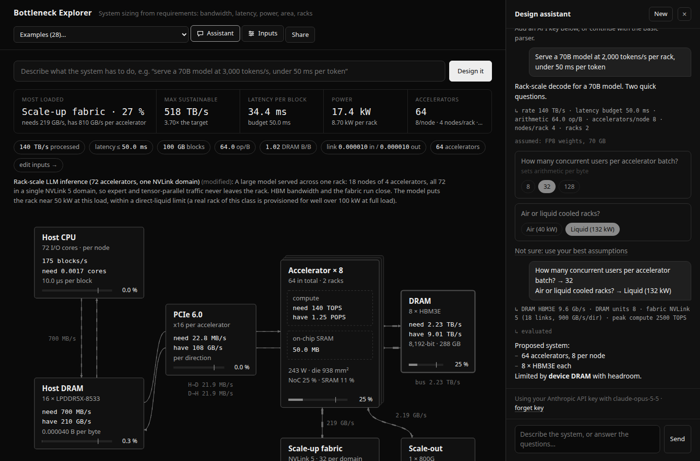

## Demo without a key

**Watch a demo** (next to *Design it*) replays an assistant session, with no API key needed. Its tool calls
run for real, so the page changes as you watch. It is a recorded session with OpenAI gpt-6-sol (26 October
2026). Asked to serve a 70B model to 2,000 users at 20 tokens/s each, under 100 ms per token, it starts from
the LLM server example and asks three questions: precision, context length, and what the 100 ms means. It then
runs the optimiser and trims the hardware. It ends on four 8-accelerator servers with three HBM3E stacks each:
46 ms at p99, compute the limit at 54 %, 17 kW at full load. Every figure in its reply matches the model's
replay of the session.

`OPENAI_API_KEY=… node tools/record_demo.js` (or `GEMINI_API_KEY`, `OPENROUTER_API_KEY`,
`ANTHROPIC_API_KEY`) records a real session through the same page and embeds it between the
`DEMO-START` / `DEMO-END` markers. The demo then says it is a recorded session, naming the model and the
date. The key stays in your environment and goes only to that provider's API.

Shared links show a social-preview card (`og.png`, rendered by `tools/og.js`).

## On-chip interconnect

Each accelerator has an on-chip interconnect and SRAM banks. It can be a network-on-chip (2-D mesh,
torus, ring or full crossbar) or one of the AMBA fabrics:

- **CHI**: a coherent mesh in the style of Arm's CMN, where snoops and responses share each link.
- **AXI5** and **ACE5**: crossbars of masters and memory-side slave ports, with independent read and
  write channels (ACE adds snoop channels).
- **AXI4-Stream**: parallel point-to-point pipelines.
- **AHB5**: a shared bus, one transfer at a time, with reads and writes taking turns.
- **APB**: registers only.

Choosing a type sets its typical width and clock. DRAM, host-link and peer traffic enter at the die
edge, and tile-to-tile traffic follows a pattern (all-to-all, nearest neighbour, or mostly local).
Each kind is checked where it actually saturates: edge channels, bisection and tile ports for a NoC;
memory ports, master ports and the crossbar for AXI; pipeline entries and the busiest link for
streams; the single bus for AHB and APB. SRAM bank bandwidth is checked for all of them. The Notes tab
covers AXI outstanding transactions (bandwidth × DRAM latency) and warns when AHB or APB is asked to
carry bulk data. The *On-chip* tab draws the chosen fabric and compares all ten at their typical
settings. Edge-device and FPGA examples use AXI; the detector trigger uses AXI4-Stream.

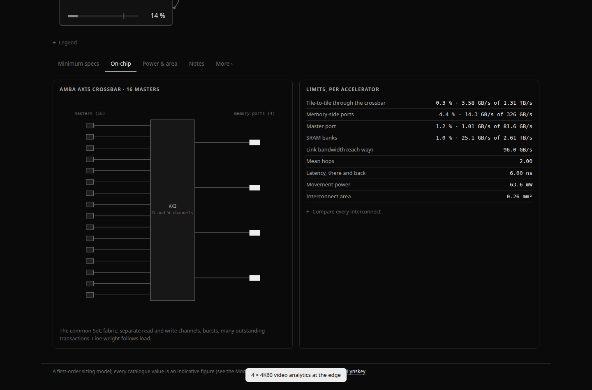

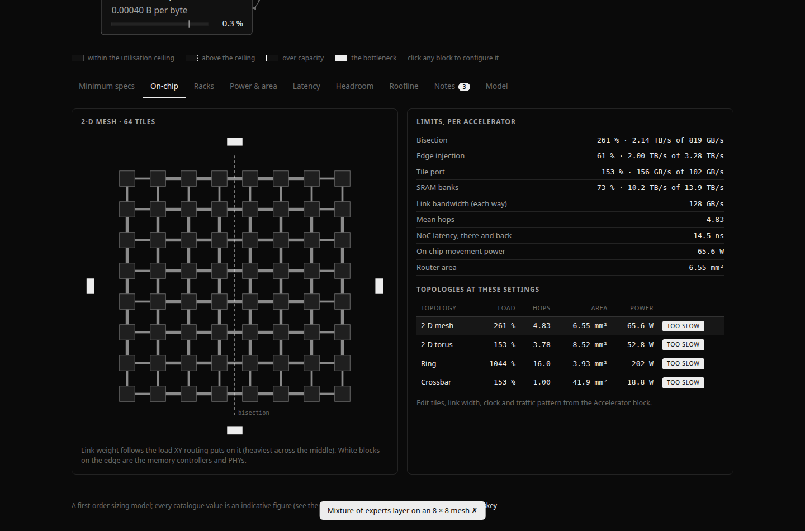

## How this is checked

The *Checks* tab (under More) compares the model with published figures:

| Reference | What it tests | Result |
| --- | --- | --- |
| H100 SXM: 3.35 TB/s HBM3 | DRAM speed-grade arithmetic (5 stacks at 5.2 Gb/s) | −0.7 % |
| Apple M2 Max: 409.6 GB/s | LPDDR5-6400, 512-bit | 0.0 % |
| Jetson AGX Orin: 204.8 GB/s | LPDDR5-6400, 256-bit | 0.0 % |
| AMD MI300X: 5.3 TB/s · MI355X: 8 TB/s | HBM3 and HBM3E, 8 stacks | +0.5 %, +2.4 % (AMD rounds 8.19) |
| Intel Gaudi 3: 3.7 TB/s · Google TPU v5p: 2,765 GB/s | HBM2E, 8 and 6 stacks | −0.4 %, 0.0 % |
| EPYC Genoa STREAM Triad: about 376 GB/s per socket | DRAM efficiency model (refresh, row misses, turnaround) | +5.2 % |
| PCIe 5.0 x16 pinned copies: 56.2 GB/s H→D, 55.1 GB/s D→H | PCIe protocol overheads | −0.2 %, +0.4 % |
| DGX H100: 10.2 kW maximum | System composition: accelerators, hosts, switches, NICs, fans, power supplies | −18 % (a planning maximum) |
| GB200 NVL72: about 120 kW per rack | Rack composition, liquid cooled | −5.0 % |
| GB200 NVL72 compute tray: 6.3 kW maximum | Node composition: 4 GPUs, 2 Grace, NICs, DPUs, drives, 48→12 V | −3.0 % |
| MLPerf v5.0 Llama 2 70B, 8 × H200: 34,988 tokens/s | LLM serving: decode and prefill, best batch and parallelism | +11.5 % |

Four more are calibration points rather than validations. Energy per operation is set from the H100 (700 W)
and B200 (1,000 W) TDPs. The cost model's packaging price and effective defect density were chosen with two
published build-cost estimates in view: H100 about $3,320 (Silicon Analysts, −7.4 %) and B200 about $6,400
(Epoch AI, −7.6 %). Every reference links its source in the app.

Three rows are indicative rather than pass/fail. They apply the energy per operation calibrated on NVIDIA parts
(H100's for 5 nm-class chips, B200's for MI355X) to other vendors' accelerators at full load: AMD MI300X comes out
+24 % (750 W published), MI355X −22 % (1,400 W) and Intel Gaudi 3 −26 % (900 W). So one energy-per-operation figure
carries across vendors to about ±25 %; to model a specific part closely, set its pJ/op from its own TDP.

The LLM workload is checked against MLPerf Inference v5.0 (Llama 2 70B, Offline, 8 GPUs). The search runs every
batch and tensor-parallel size whose KV caches fit in memory, with compute at the default 60 % of peak and
operations counted in 8-bit equivalents (FP4 weight matmuls at twice the rate, attention no faster than 8-bit). The
mean prompt, 222.33 tokens, was measured from MLCommons' 24,576-sample dataset file by the sibling AI Accelerators
Explained site, and MLPerf's reference reply is 294.45 tokens. Both rows had ±25 % fixed before the run.
- **H200 at FP8:** the model gives 39,029 tokens/s against 34,988 published, +11.5 %.
- **B200 at FP4:** the model gives 176,631 against 98,858, +79 %, a known miss shown as a labelled row rather than
  tuned away. Prefill makes both compute-bound, and the model gives FP4 the same share of its peak as FP8. The
  published B200 ÷ H200 ratio is 2.8×, against 4.5× for peak FP4 ÷ FP8, so FP4 reaches a smaller share of its peak
  in practice.

Fans and power conversion are no longer a flat 15 %. They follow the rack's cooling, read from its power limit.
Air-cooled racks add 8 % for fans and lose 5 % in Titanium server supplies. Direct-liquid racks add 2 % for fans
and lose power twice, in ORv3 power shelves (96.5 %) and in each tray's 48→12 V converter (97.5 %). The
reference hosts are built from their parts lists (CPUs, DIMMs, drives, storage NICs, DPUs, BMC). DGX H100 still
sits 18 % low. Its 10.2 kW is a provisioning maximum with fans at full speed, and fan power is the likeliest gap.
NICs are counted only when traffic leaves the system (scale-out traffic above zero), so independent copies of a
model no longer pay for a network they don't use.

`npm test` (also run in GitHub Actions on every push) reruns these checks in headless Chrome. It also
checks that every overhead breakdown multiplies out to the model's capacities, that the optimiser finds a
design for every example that can be fixed, that the rate sweep finds a design at every rate, that compare
round-trips through a shared link, that every example (changed or not) survives a short link exactly, that each
spec sheet fits one A4 page, that each explanation works out to its headline figure, that the LLM serving and training workloads match hand calculations, that the cost parts add up and the
cost goal finds the cheapest design, and that all 31 examples match their golden results within 2 %. An axe-core
audit then checks the page, all 13 tabs, the drawers, the spec sheet and an explanation panel for accessibility
violations, with none allowed. Text meets WCAG AA contrast. Tables that scroll sideways, the headline figures and
the diagram's blocks are reachable by keyboard. Focus moves into a drawer when it opens and back when it closes,
and closed drawers are out of the tab order. Every view fits a 390 px phone screen without sideways scrolling.

## Design optimiser

The *Optimise* tab searches every DRAM type and speed grade, the host link, the on-chip interconnect, the
scale-up fabric and the NICs. Where they limit, it also raises peak compute and SRAM banks, widens host
memory (up to 12 channels, then faster DDR) and adds host cores. When a design misses the latency budget, it
widens whichever transfer dominates (more DRAM units or a wider link). It adds accelerators, if allowed, only
when nothing fits with the count as it is. It returns the best design for power, die area or a balance of the two, plus the
trade-off between them, each design one click from being applied.

Practical limits apply unless you switch them off:

- DRAM within its usual width;
- PCIe x4 to x16, with an on-package UCIe host link only when allowed;
- AXI and ACE crossbars of at most 32 masters, buses and rings of at most 16;
- one reticle, optionally.

A search takes about 20 ms. The assistant can call it as a tool.

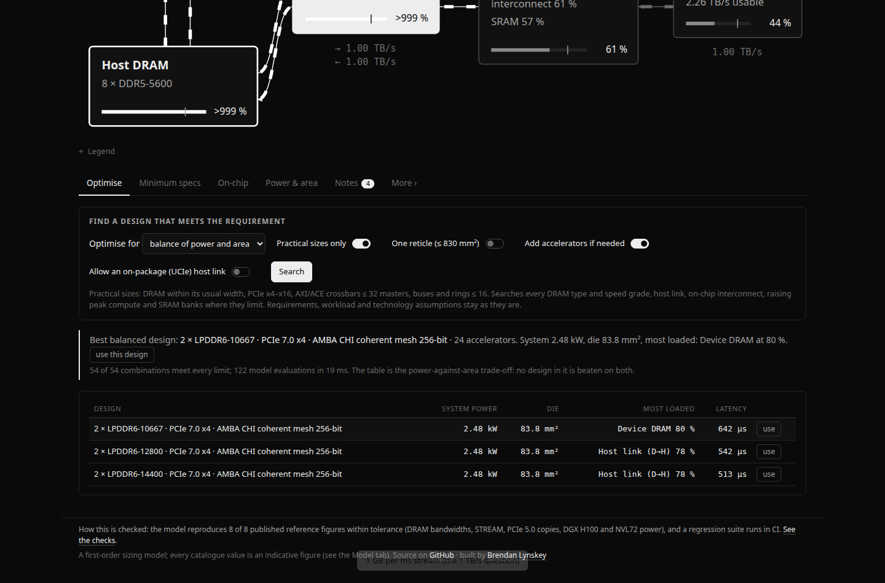

Applying a design from the table pins the one you had as A, so the change is compared straight away (below).

## Rate sweep: where the design has to step up

The *Rate sweep* tab asks the sizing questions again at 25 rates from a hundredth to a hundred times the
target. First, for the accelerators you have, it shows the lowest-power practical device DRAM at each rate as a
band, with each boundary found by bisection. A sentence sums it up, for example "LPDDR5X up to about 4.9 GB/s,
then LPDDR6 up to about 196 GB/s, then HBM4". Below that it plots the DRAM power of the fastest grade of each
type. A line goes faint where the width is a stretch and stops where the type becomes impractical.

Then it runs the optimiser at every rate and plots the system power and die area of the cheapest whole
design. Your current design (and a pinned A) is drawn up to the rate where it runs out of capacity. A table lists
where the DRAM type changes and where accelerators have to be added. The sweep takes about 0.4 s and runs in
the background.

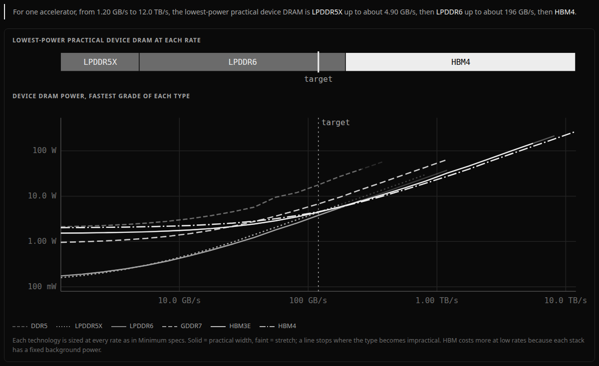

## Compare two designs

*Compare* pins the current design as A. Change anything, and a line under the weakest-link strip shows how
the current design (B) differs on power, die area, maximum rate and latency. Bold means better than A.
*details* opens the full table: the components that changed, the most loaded part, full-load power and energy
per byte. *swap* exchanges A and B, and *re-pin* makes B the new A. The shared link carries A too, so a link
opens the comparison as you left it.

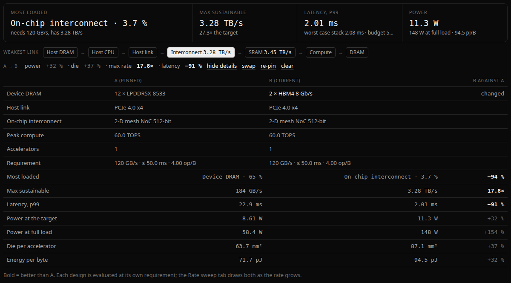

## Spec sheet

*Spec sheet* (next to *Edit inputs*) puts the current design on one page: the requirement and the result,
every part with its quantity and power (adding up to the system total, fans and conversion included), the
load on every limit, and the open issues from the Notes tab. *Print or save as PDF* prints just the sheet in
black on white, on one A4 page. Printing from the browser's menu prints the sheet too. The sheet carries the
design's share link, so a printed copy leads back to the live model.

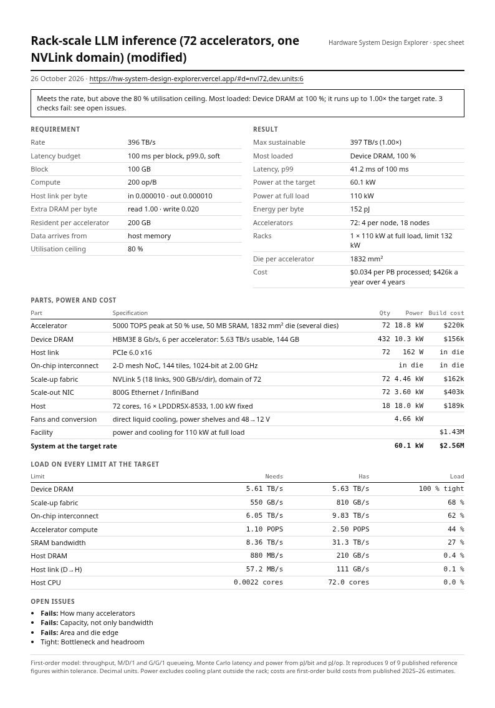

## How each figure is worked out

Click any of the five figures at the top (most loaded part, maximum rate, latency, power, cost) and the sum behind
it opens underneath, with this design's numbers in it:
- **Load:** demand at the peak (rate ÷ accelerators × peak-to-average × bytes per byte) against capacity (for
  example DRAM units × peak × efficiency).
- **Latency:** every stage as fixed delay + transfer + queueing.
- **Power:** each part's energy per bit or per operation, times the counts, plus fans and conversion.
- **Cost:** a year's write-off and electricity divided by a year's work.

The test suite checks that each explanation ends on exactly the figure shown, in every example.

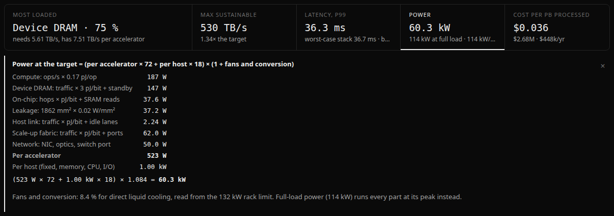

## LLM serving: from the model to the workload

*LLM serving* (top of Inputs) derives the workload from the model instead of asking for bytes and op/B. Pick a
model (Llama 3.1 8B, 70B or 405B, Mixtral 8×7B, DeepSeek-V3, or a custom shape), the weight and KV-cache
precision, how many users decode at once, tokens per second per user, users per copy of the model (the batch)
and the average context. Each copy reads every weight once per decode step, plus the KV cache of every user in
its batch:

- **rate** = users × tokens/s × (weights ÷ batch + KV cache per user), counted as DRAM reads;
- **latency budget** = one decode step, 1 ÷ tokens/s;
- **op/B** = batch × (2 × active parameters + attention over the context) ÷ bytes read per step;
- **resident data** per accelerator = (copies × weights + every user's KV cache) ÷ accelerators;
- **peer traffic** = two all-reduces of the activations per layer across the accelerators of one copy.

The derived inputs are locked while it is on, and follow the accelerator count, so the optimiser and the rate
sweep work as usual (the sweep scales the users). For Llama 3.1 70B at 8 bits, 2,000 users at 20 tokens/s,
500 per copy and 4k-token contexts, that is 32.5 TB/s of reads, and 83 % of each step is KV cache rather than
weights. The test suite checks the rate against the same sum done by hand.

*Include prefill* adds the prompts. Each request brings a prompt and gets a reply, so prompt tokens arrive at
users × tokens/s × prompt ÷ reply. They are chunked into the same steps as decode (2,048 tokens a chunk, as vLLM
and SGLang do), so they add no weight reads. They add arithmetic (2 × active parameters per token plus causal
attention), KV-cache writes, and re-reads of each prompt's KV cache chunk by chunk. The context then averages the
prompt plus half the reply, and the summary gives the shortest possible time to first token: one prompt alone on its
copy's compute. With 3,600-token prompts and 1,000-token replies, prompts are about three quarters of the
arithmetic, and the example becomes compute-bound.

*Split prefill and decode across two pools* (with prefill on) makes the hardware the decode pool and adds a prefill
pool of the same accelerators, with its own node and rack counts and a time-to-first-token budget. That is how
production serving increasingly runs (DistServe, Splitwise, NVIDIA Dynamo).
- **Prefill pool:** reads only the prompts. Each chunk reads the weights once, copies span a node, and its latency
  budget is the time to first token.
- **Decode pool:** no longer does the prompts' arithmetic.
- **Between them:** each prompt's KV cache crosses the network.
- **Combined:** the headline load, maximum rate, power and cost cover both pools, so Compare can set split against
  colocated.

The example *Prefill and decode on separate pools* shows why it matters. On 48 accelerators in one pool the prompts'
arithmetic stretches each decode step to 73 ms against a 50 ms budget. Split 16 for decode and 32 for prefill, decode
steps stay inside the budget and the first token comes in about 140 ms. Tests check that the arithmetic divides
exactly between the pools and that power and capital add up.

The new example *LLM serving from the model's shape* starts here, and the assistant has a matching
`set_llm_workload` tool.

## LLM training

*LLM training* (in Inputs, below serving) derives the workload for pre-training from the model's shape, the precision
(BF16 or FP8), training tokens per second, sequence length, global batch, micro-batch, and tensor and pipeline
parallelism. Data parallelism is whatever the accelerator count leaves.

- **Arithmetic:** 6 × active parameters per token plus attention (Kaplan et al.), 8 with activation recomputation,
  raised by the pipeline bubble (pp − 1) ÷ (micro-batches × interleaved stages).
- **DRAM:** the weight shard read three times per micro-batch, FP32 gradient accumulation, activations written
  forward and read back (34 × hidden bytes per token per layer, Korthikanti et al.; 2 with recomputation), and the
  optimiser's state once a step.
- **Memory per accelerator:** BF16 weights, FP32 gradients and 12 bytes of FP32 master weights and Adam moments per
  parameter (sharded over data parallel with ZeRO-1), plus the activations of the micro-batches in flight.
- **Peer traffic:** four all-reduces per layer per token across tensor parallel, activations across pipeline stages,
  and the gradient all-reduce across data parallel once a step. Each goes over the scale-up fabric if its group fits
  in the domain, otherwise over the network.

The summary gives the parallel layout, the bubble, memory, traffic, the maximum tokens/s on the hardware, and the
days and cost of a whole run (15T tokens by default). Cost is per million training tokens. The new example *LLM
training from the model's shape* (Llama 3.1 70B, BF16, 1,024 accelerators) is compute-bound at 62 % with a 19 %
bubble. Tests check the arithmetic and memory against the formulas by hand.

The training model is not checked against a published run. The public ones don't give enough detail to make it a
real test: Meta's Llama 3.1 405B run used interleaved pipeline schedules and memory settings that aren't fully
published, and its 70B run's parallelism isn't published at all. Choosing those settings until the GPU-hours match
would be fitting, not checking.

## Cost

The *Cost* tab, and a fifth figure in the strip at the top, put a price on the design.

- **One accelerator, built:** the dies (wafer price, dies per wafer, yield from area and an effective defect
  density; above the reticle the logic splits into dies that yield separately), device DRAM per GB, the
  package (an interposer priced by the silicon on it for HBM parts), the package's yield loss, and the board.
- **The system:** accelerators, scale-up fabric, network ports, hosts, and the facility, sized for full-load
  power at $11–13 per watt by cooling type.
- **Per year:** hardware written off over 4 years (adjustable), the facility over 15, and electricity at the
  target power × PUE.
- **Unit cost:** per million tokens with the LLM workload on, otherwise per PB processed.

The default is build cost, what the parts cost to make. *Purchase price* adds a vendor gross margin on the
accelerators (NVIDIA reports about 75 %). Electricity price, write-off period and the share of time at the
target rate are under *Cost assumptions* in Inputs. Wafer, HBM, packaging and facility prices come from published
2025–26 estimates (Epoch AI, Silicon Analysts, JLL, DigiTimes); fabric, network and host prices are rough
assumptions. Cost also appears on the spec sheet and in Compare, and the optimiser can aim for the lowest cost
a year.

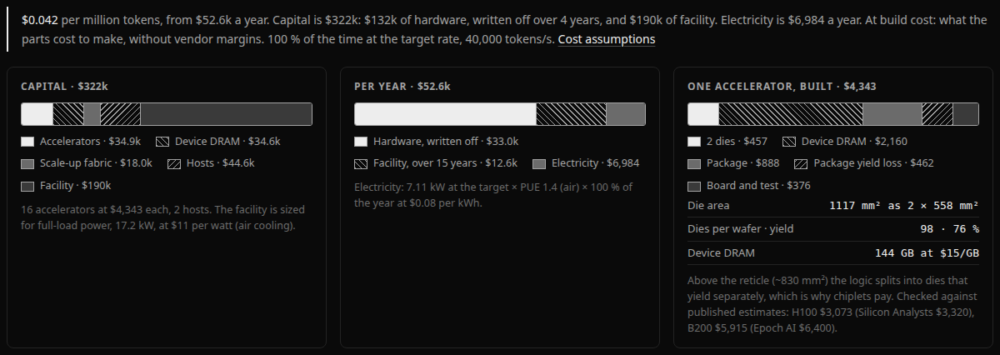

## Short share links

The address holds the example the design started from plus only the fields that differ from it, so an unchanged
example is `#d=nvl72` and a changed one reads like `#d=nvl72,T:2e12,dev.units:6`. A pinned A follows as
`&a=…` in the same form. Links that changed designs typically stay well under 150 characters, against about
1,350 when the whole state was stored. Older links, which held the full state as base64 JSON (`#s=…`), still
load. A short link names its example, so if that example is edited in a later version, the link opens the
edited version plus the same changes.

## Overheads, raw to usable

Every link's drawer breaks its rate down from raw to usable, and the products are exactly the efficiencies
the model uses:

- **PCIe:** 128b/130b or FLIT FEC/CRC, TLP headers at your payload and completion sizes, DLLPs or replays,
  and the read requests that ride the opposite direction.
- **UCIe and fabrics:** flit headers and CRC.
- **Ethernet:** preamble and inter-packet gap, frame headers, IP/UDP.
- **DRAM:** refresh, row misses and bank conflicts, read/write turnaround, inline ECC, LPDDR6 metadata.
- **On-chip:** header, credit, snoop and arbitration overhead.

The Minimum specs link table shows each option's total overhead.

DRAM now comes as **51 speed grades in 16 types**, for example DDR5-4800 to 7200, GDDR6 14–20 Gb/s,
HBM3 5.2–6.4 Gb/s, HBM3E 8.0–9.8 Gb/s and HBM4 6.4–10 Gb/s. You pick the type, the speed grade and the
number of channels, devices or stacks.

## Variability, percentiles and the weakest link

Sizing everything for the same simultaneous peak, and adding up every stage's worst latency, stacks
tolerances to a worst case that rarely happens. A collapsed *Variability & tolerances* section offers
the alternative:

- **Deadline: soft or hard.** A soft deadline is judged at a percentile (p99, p99.9 or p99.99) of a
  Monte Carlo of the whole path. Each stage's delay is lognormal around its mean; long transfers average
  out their jitter, compute keeps its data-dependent jitter, and queueing waits vary about as much as
  their mean. A hard deadline (trading, triggers, 5G slots) keeps the worst-case stack of per-stage
  percentiles. The Latency tab shows the histogram with p50, the percentile, the worst-case stack and the
  budget, so the margin that stacking would waste is visible.
- **Do peaks line up?** Independent or partly correlated bursts smooth out where many streams share a
  resource: a host serving eight accelerators is sized for a smaller peak than any one of them sees.
  Fully correlated reproduces the worst case.
- **Arrival burstiness and jitter** feed Kingman's G/G/1 queueing formula. Clocked work such as LLM
  decode steps and camera frames arrives regularly; random requests are Poisson.
- **Catalogue tolerance** (±10–30 %) draws every capacity figure at random and reports how often the
  design stays under the ceiling, and which component turns out weakest.

A **weakest-link** strip under the headline figures lists every component on the data path, in order,
with the rate it alone could sustain. The weakest is inverted and sets the system's maximum rate. With
tolerance on, each link also shows how often it came out weakest.

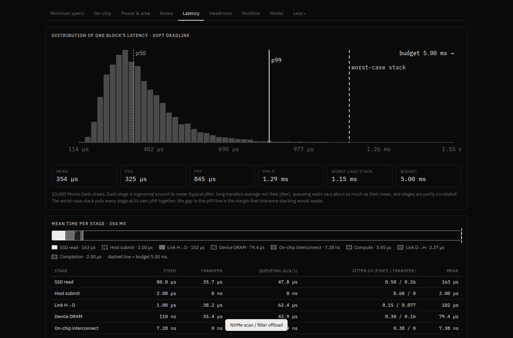

## The question it was built for

*A system has to process 1 GB of data per millisecond. How wide would a bank of LPDDR4 at full speed
have to be? Would it need HBM? If every byte processed also has to cross the host link in each
direction, what link does it need?*

1 GB/ms is 1 TB/s. At 3200 MT/s an x16 LPDDR4 channel peaks at 6.4 GB/s, so even at 100 % efficiency
with no headroom the bus would be about **2,500 bits wide**. At a realistic 92 % streaming efficiency
and an 80 % utilisation ceiling it is **213 channels, a 3,408-bit bus**: about 7,000 signal balls,
190 mm of PHY beachfront on the die and roughly 230 mm² of PHY. That is far beyond the 256-bit to
1024-bit that LPDDR is ever built at. Two HBM3E stacks carry the same traffic with 14 mm of edge.
The link is the harder problem: a PCIe 5.0 x16 delivers about 52 GB/s per direction after encoding
and TLP overhead, so 1 TB/s each way needs 24 of them (6 even at PCIe 7.0). The tool's answer is to
move less data across the link, or to put the accelerator on the package. It also shows that the host's own DRAM
would have to carry 4 TB/s to feed that link.

## What's inside

- **Live data-flow diagram**: moving dashes on every path, with each block marked by its
  utilisation against your ceiling. The bottleneck is flagged. Click a block to configure it.
- **Verdict strip**: the bottleneck, the maximum sustainable rate, latency per block against the
  budget, system and per-rack power, and the accelerator count.
- **Minimum specs**: every DRAM technology (DDR4/5, LPDDR4/4X/5/5X/6, GDDR6/6X/7, HBM2 to HBM4)
  sized for the requirement, with bus width, capacity, power, PHY area, beachfront, signal pins and a
  practical / stretch / impractical verdict. Also every link (PCIe 3.0 to 7.0, UCIe), host memory
  channels, scale-up fabrics, scale-out NICs, compute, host cores, network ports and SSDs. One click
  applies any option.
- **Rate sweep**: the lowest-power practical DRAM at every rate from a hundredth to a hundred times the
  target, and the optimiser's cheapest whole design at each rate (see above).
- **Compare**: pin a design as A and see how the current one differs (see above).
- **Cost**: build cost of one accelerator, capital and running cost of the system, and cost per million tokens
  or per PB (see above).
- **PPA**: power broken down by component, a die-area estimate that switches to *pad-limited* when
  the memory and link PHYs need more edge than the logic provides, a reticle-limit check, and a DRAM
  design-space plot of power against PHY area.
- **Latency budget**: one block through every stage (fixed cost, transfer, M/D/1 queueing), plus
  sweeps of latency and host-core load against block size.
- **Headroom**: the utilisation of every component as the rate scales. The first line to cross
  100 % is the bottleneck, and the next line shows what fixing it buys.
- **Roofline**: arithmetic intensity against device DRAM, the ridge point, and a second roof set
  by the rate the host link can feed.
- **Considerations**: checks generated from the current design. They cover half-duplex DRAM against
  full-duplex links, access-pattern efficiency, capacity, PCIe TLP efficiency, outstanding read tags
  (Little's law), DRAM concurrency, CPU cost per block, host memory on the data path, queueing,
  on-chip buffering, data-movement power, beachfront, HBM packaging and ECC.
- **31 example applications**, AI first, each with a note on what it shows. The ones marked ✗ are
  deliberately broken designs that illustrate a classic bottleneck:
  - *AI & LLMs*: rack-scale inference on 72 accelerators in one NVLink domain, a 1,024-accelerator
    training cluster over 32 racks, tensor-parallel prefill on 8 PCIe cards ✗, a mixture-of-experts
    layer that overloads its mesh ✗, LLM serving (one pool, or prefill and decode on separate pools) and LLM training derived from Llama 3.1 70B's shape, LLM decode on an
    8-accelerator server and at the edge, prefill on one accelerator, DLRM embedding lookups, and a data
    loader starving an accelerator ✗.
  - *Fundamentals*: the 1 TB/s question.
  - *Imaging & video*: 4 × 4K60 edge analytics, an 8K60 encoder, line-scan vision, a smartphone ISP +
    NPU, an ultrasound beamformer, an autonomous-driving SoC.
  - *Signal processing & comms*: radar/SDR over 400 GbE, a 5G O-RAN DU, a radio-telescope correlator,
    a trading feed handler ✗, a detector trigger ✗.
  - *Data, storage & networking*: NVMe scan offload, a GPU database join over PCIe ✗, 400 GbE TLS
    offload, storage compression.
  - *Science, HPC & crypto*: a CFD stencil, genomic alignment on an FPGA card, an FHE bootstrapping
    accelerator.
- **Share links**: short, in the URL: the example plus what you changed. A one-page **spec sheet** prints or saves as PDF.

## The model

Everything flows from the processing rate *T*, the bytes of input processed per second. For each
component:

- **demand** = *T* × peak-to-average ratio × bytes that component moves per processed byte;
- **capacity** = peak × efficiency;
- **utilisation** = demand ÷ capacity. The bottleneck is the component with the highest utilisation.

How each kind of component is treated:

- **DRAM.** Efficiency depends on the access pattern, a read/write turnaround penalty and inline-ECC
  overhead. Reads and writes share one half-duplex bus.
- **PCIe.** Usable rate = raw × encoding (128b/130b, or 236/256 in FLIT mode) × payload ÷ (payload
  + header + framing) × DLLP overhead. Each direction is sized separately, and completion size and
  read requests are counted.
- **Power** is average traffic × energy per bit for each technology, plus standby power per unit,
  compute pJ/op and leakage per mm², plus hosts, NICs where traffic leaves the system, and fans and
  power-conversion losses set by the rack's cooling (about 14 % air-cooled, 8 % direct liquid).
- **Area** is compute + SRAM + PHYs + 15 %. It is replaced by the pad-limited area when a square die
  would not have enough edge for the PHYs.
- **Cost** is dies (wafer ÷ good dies per wafer, Poisson yield) + device DRAM + package + package yield loss +
  board, then fabric, network, hosts and facility; per year, hardware and facility written off plus electricity.

All catalogue numbers are indicative, first-order figures for a 5 nm-class accelerator (JEDEC data
rates, public datasheets and published estimates). They are good for seeing which component limits
and by roughly how much, not for sign-off. The *Model* tab in the app lists every value.

## Running locally

It is one self-contained `index.html` file with no build step: open it in any modern browser. `npm install && npm test` runs the checks, including mocked runs of the assistant against each provider's API.
