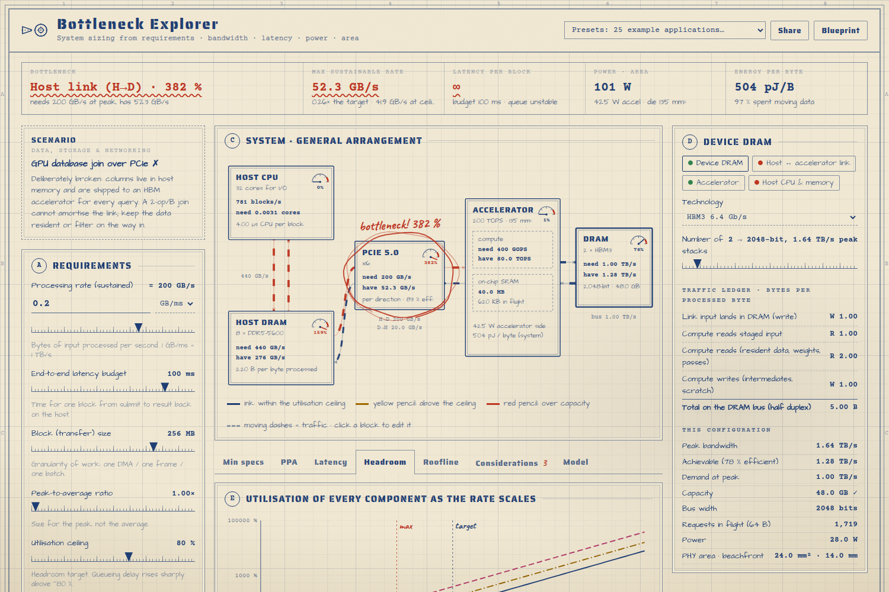
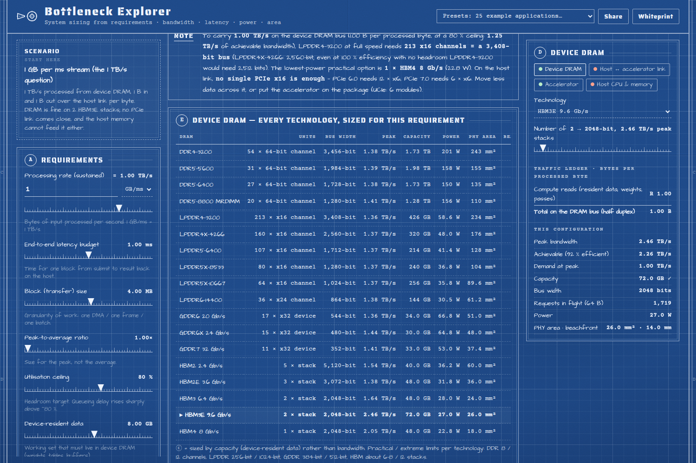
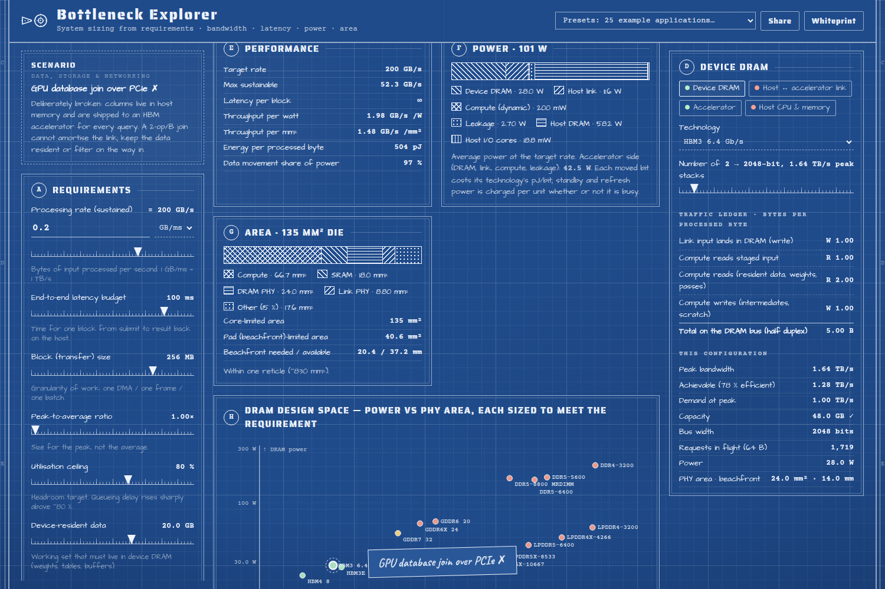
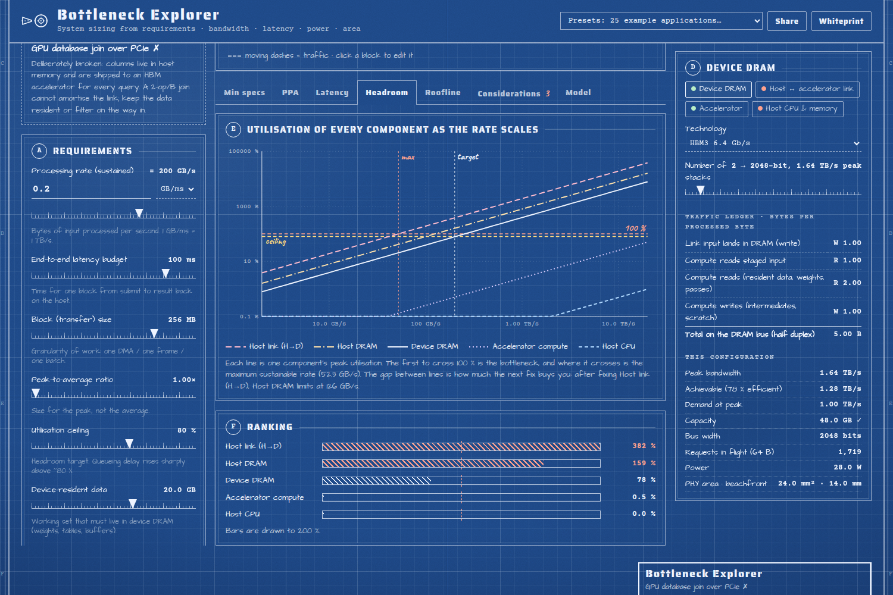

# Bottleneck Explorer

An interactive sizing tool for data-processing systems: a host CPU and its memory, a host link
(PCIe or on-package UCIe), an accelerator with on-chip SRAM, and device DRAM, optionally fed from the
network or NVMe storage. You set the requirements (processing rate, latency budget, block size,
peak-to-average ratio, headroom) and the workload (bytes over the link and through DRAM per byte
processed, arithmetic per byte), and it shows which component is the bottleneck. It also gives the
minimum specification of every component, and the power, performance and area (PPA) of the result.

**Live app:** https://brendanjameslynskey.github.io/Data_Bottleneck_Explorer/

## The look: an engineer's blueprint

The whole app is drawn as an old engineering print instead of a dashboard:

- **Paper:** cyanotype blue with grain, uneven exposure and fold creases.
- **Sheet:** a double-ruled border with zone references, and a third-angle projection symbol as the logo.
- **Lettering:** stencil titles, draftsman's hand for labels and typewriter figures.
- **Title block:** drawn by, checked, scale, drawing number and revision. *Checked* reads "passes ✓"
  or "see notes ✗"; the revision goes to B when you edit a preset.
- **Status:** ink means within the utilisation ceiling, yellow pencil above it, red pencil over capacity.
- **Annotations:** the bottleneck is circled by hand in red pencil and every block carries a 0–100 % gauge.
- **Charts:** hatching instead of colour fills, dash patterns to tell the lines apart, and rubber
  stamps (*practical*, *stretch*, *impractical*, *fail*, *check*) for verdicts.

A *Whiteprint* button switches to the diazo print: blue ink on cream paper.

## The question it was built for

*A system has to process 1 GB of data per millisecond. How wide would a bank of LPDDR4 at full speed
have to be? Would it need HBM? If every byte processed also has to cross the host link in each
direction, what link does it need?*

1 GB/ms is 1 TB/s. At 3200 MT/s an x16 LPDDR4 channel peaks at 6.4 GB/s, so even at 100 % efficiency
with no headroom the bus would be about **2,500 bits wide**. At a realistic 92 % streaming efficiency
and an 80 % utilisation ceiling it is **213 channels, a 3,408-bit bus**: about 7,000 signal balls,
190 mm of PHY beachfront on the die and roughly 230 mm² of PHY. That is far beyond the 256-bit to
1024-bit that LPDDR is ever built at. Two HBM3E stacks carry the same traffic with 14 mm of edge.
The link is the harder problem: a PCIe 5.0 x16 delivers about 52 GB/s per direction after encoding
and TLP overhead, so 1 TB/s each way needs 24 of them (6 even at PCIe 7.0). The tool's answer is to
move less data across the link, or to put the accelerator on the package. It also shows that the host's own DRAM
would have to carry 4 TB/s to feed that link.

## What's inside

- **Live data-flow diagram**: animated traffic on every path, with each block coloured by
  utilisation against your ceiling. The bottleneck is flagged. Click a block to configure it.
- **Verdict strip**: the bottleneck, the maximum sustainable rate, latency per block against the
  budget, system power, die area and energy per processed byte.
- **Minimum specs**: every DRAM technology (DDR4/5, LPDDR4/4X/5/5X/6, GDDR6/6X/7, HBM2 to HBM4)
  sized for the requirement, with bus width, capacity, power, PHY area, beachfront, signal pins and a
  practical / stretch / impractical verdict. Also every link (PCIe 3.0 to 7.0, UCIe), host memory
  channels, compute, host cores, network ports and SSDs. One click applies any option.
- **PPA**: power broken down by component, a die-area estimate that switches to *pad-limited* when
  the memory and link PHYs need more edge than the logic provides, a reticle-limit check, and a DRAM
  design-space plot of power against PHY area.
- **Latency budget**: one block through every stage (fixed cost, transfer, M/D/1 queueing), plus
  sweeps of latency and host-core load against block size.
- **Headroom**: the utilisation of every component as the rate scales. The first line to cross
  100 % is the bottleneck, and the next line shows what fixing it buys.
- **Roofline**: arithmetic intensity against device DRAM, the ridge point, and a second roof set
  by the rate the host link can feed.
- **Considerations**: checks generated from the current design. They cover half-duplex DRAM against
  full-duplex links, access-pattern efficiency, capacity, PCIe TLP efficiency, outstanding read tags
  (Little's law), DRAM concurrency, CPU cost per block, host memory on the data path, queueing,
  on-chip buffering, data-movement power, beachfront, HBM packaging and ECC.
- **25 example applications** in six groups, each with a one-line note on what it shows. The ones
  marked ✗ are deliberately broken designs that illustrate a classic bottleneck:
  - *Start here*: the 1 TB/s question.
  - *Imaging & video*: 4 × 4K60 edge analytics, an 8K60 broadcast encoder, line-scan machine vision,
    a smartphone ISP + NPU, a 128-channel ultrasound beamformer, an autonomous-driving perception SoC.
  - *Signal processing & comms*: a radar/SDR front end over 400 GbE, a 5G O-RAN distributed unit, a
    radio-telescope correlator, a low-latency trading feed handler ✗, a particle-detector trigger ✗.
  - *AI & ML*: LLM decode at the edge and in the datacentre, LLM prefill, a training step, DLRM
    embedding lookups, and a data loader starving a GPU ✗.
  - *Data, storage & networking*: an NVMe scan offload, a GPU database join over PCIe ✗, 400 GbE TLS
    offload, storage compression.
  - *Science, HPC & crypto*: a CFD stencil, genomic read alignment on an FPGA card, an FHE
    bootstrapping accelerator.
- **Share links**: the whole configuration lives in the URL.

## The model

Everything flows from the processing rate *T*, the bytes of input processed per second. For each
component:

- **demand** = *T* × peak-to-average ratio × bytes that component moves per processed byte;
- **capacity** = peak × efficiency;
- **utilisation** = demand ÷ capacity. The bottleneck is the component with the highest utilisation.

How each kind of component is treated:

- **DRAM.** Efficiency depends on the access pattern, a read/write turnaround penalty and inline-ECC
  overhead. Reads and writes share one half-duplex bus.
- **PCIe.** Usable rate = raw × encoding (128b/130b, or 236/256 in FLIT mode) × payload ÷ (payload
  + header + framing) × DLLP overhead. Each direction is sized separately, and completion size and
  read requests are counted.
- **Power** is average traffic × energy per bit for each technology, plus standby power per unit,
  compute pJ/op and leakage per mm².
- **Area** is compute + SRAM + PHYs + 15 %. It is replaced by the pad-limited area when a square die
  would not have enough edge for the PHYs.

All catalogue numbers are indicative, first-order figures for a 5 nm-class accelerator (JEDEC data
rates, public datasheets and published estimates). They are good for seeing which component limits
and by roughly how much, not for sign-off. The *Model* tab in the app lists every value.

## Running locally

It is one self-contained `index.html` file with no build step: open it in any modern browser.
